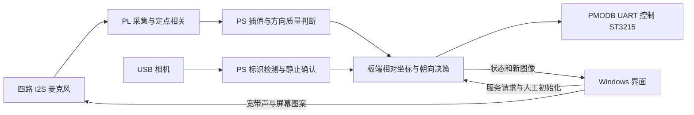

# 结构与实现方法

系统面向声音触发的主动观察：固定麦克风阵列感知方向，旋转相机获取对应视野。初始化用同一台电脑提供可确认的声学和视觉参考；初始化后，普通声音无需再次被视觉分类为电脑。

## PL 与 PS 分工

| 模块 | 实现 | 输入与输出 |
|---|---|---|
| I2S 接收 | PL | 4 根数据线、8 个时隙；统一 32 位符号扩展 |
| 频带处理 | PL | 16 tap 整数 FIR；输入算术右移 4、输出右移 2 |
| 时延统计 | PL | 6 对麦克风、每对 33 个时延点，加 4 路能量，共 202 个累加值 |
| 时间一致性 | PL | 4 个子窗的 808 个统计值、24 个子峰及 guard |
| 亚采样时延与几何 | PS | 正峰筛选、局部插值、物理时延范围与几何一致性判断 |
| 视觉 | PS / OpenCV | 页面标识候选、几何检查、静止新图确认和转轴估计 |
| 任务管理 | PS | 同 boot 身份、请求持久化、资源独占、错误与完成回执 |
| 桌面 | Windows Python + HTML/JS | 自动连接、启动请求、显式初始化、播放第一测试音和显示状态 |

采样率为 31250 Hz；采集传输保留 8 槽，选用槽 0、4、6、7，对应 MIC01、MIC05、MIC07、MIC08。FCLK0 为 100 MHz，BCLK 为 2 MHz。FIR 系数为前 8 项 +1、后 8 项 -1：

`y[n] = (sum(x[n-k] >> 4, k=0..7) - sum(x[n-k] >> 4, k=8..15)) >> 2`

所有移位均为有符号算术移位。复位与重新启动清除历史，预跳过的帧不进入 FIR 历史；零初史和边界行为纳入仿真。

对通道 i、j 计算 `Rij[k] = Σ yi[n]·yj[n+k]`，k 范围为 -16..16。方向解算使用阵列实际坐标和成对时延约束。固定阵列的声音方向属于 `ARRAY_FIXED`，不会直接叠加相机轴角度。几何坐标来源保存在工程的 `component_coordinates_V20.csv`。

## 初始化与跟随

初始化扫描中，运动图像用于寻找参考，不能替代静止确认。程序选择有效标识匹配，返回候选朝向后获取本次触发的静止图像测轴；只有声学参考、图像、转轴和清理记录满足条件才建立映射。标识匹配分数描述模板与几何支持程度，不是一般物体分类概率。

对齐关系可概括为 `目标角 = 参考相机角 + s × wrap(当前声音方位 − 参考声音方位)`。其中 s 由本次静止视觉测量确定，跨 boot 或安装变动需重新初始化。没有可靠的高度、距离和完整相机内外参时，不给出确定的三维位置。

后续声音使用当前 PL 统计产生的有效方向；不再要求它与初始化宽带波形相似。低能量、时延或子窗方向不一致、过期记录均可以拒绝。分段采样之间存在处理时间，本版本没有宣称无间隙采集。

## 接口与资源生命周期

| 地址 | 功能 |
|---|---|
| `0x43c00000` | 麦克风采集及相关统计 |
| `0x40400000` | AXI DMA S2MM |
| `0x43c10000` | 舵机 UART |
| `0x43c20000` | 板上按钮输入 |
| `0x43c30000` | 组合硬件的辅助输出接口 |

DOA ABI 为 `0x444f4105`，FIR_ID 为 `0x08040210`。PL 完成标志、统计快照和原始 PCM 均有对应身份记录。每次操作结束，程序关闭 BCLK/WS、复位并确认 DMA halt 后释放缓冲、释放相机和 UART，并保存清理状态。未知请求不会被桌面当作可重复提交的新请求。
